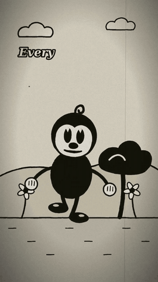

<div align="center">

# cartoonforge

**Cartoons drawn entirely in code — in the styles that made animation history.**

Pick a style · write a few lines (or record your voice) · get a 9:16 reel with voice, music and captions.

[**▶ Watch the styles**](https://aleksandrarudenya99.github.io/cartoonforge) · [Install](#install) · [How it works](#how-it-works) · [Roadmap](ROADMAP.md)

</div>

## Styles

<!-- gallery:start -->
<table>
<tr>
<td align="center" width="33%"><a href="https://aleksandrarudenya99.github.io/cartoonforge/#rubber-hose-1930"></a><br><b>Rubber Hose</b> · 1920s–1930s<br><sub>Bendy limbs, pie-cut eyes, black ink on old film. Everything bounces to the music.</sub></td>
<td align="center" width="33%"><br><br><b>UPA Modern</b> · 1950s<br><sub>Flat graphic shapes, bold colour, limited animation.</sub><br><sub><i>coming soon</i></sub><br><br></td>
<td align="center" width="33%"><br><br><b>Paper Cut-out</b> · 1990s<br><sub>Pinned paper parts, construction-paper textures.</sub><br><sub><i>coming soon</i></sub><br><br></td>
</tr>
<tr>
<td align="center" width="33%"><br><br><b>Cel Anime</b> · 1980s<br><sub>Cel shading, speed lines, dramatic framing.</sub><br><sub><i>coming soon</i></sub><br><br></td>
<td align="center" width="33%"><br><br><b>Comic Halftone</b> · 1960s<br><sub>Ben-Day dots, misregistered print, bold panels.</sub><br><sub><i>coming soon</i></sub><br><br></td>
<td align="center" width="33%"><br><br><b>Claymation</b> · stop-motion<br><sub>Squishy clay, thumbprints, 12 fps wobble.</sub><br><sub><i>coming soon</i></sub><br><br></td>
</tr>
</table>

▶ **Watch them with sound:** https://aleksandrarudenya99.github.io/cartoonforge
<!-- gallery:end -->

## Install

cartoonforge is a **skill for coding agents**. In Claude Code:

```text
/plugin marketplace add aleksandrarudenya99/cartoonforge
/plugin install cartoonforge@cartoonforge
```

or with the open skills CLI (Claude Code, Cursor, Codex, Gemini CLI…):

```bash
npx skills add aleksandrarudenya99/cartoonforge
```

Then just ask:

> Make a 15-second reel in rubber hose style about my coffee shop opening on Saturday.

> Here's my voice recording — turn it into a rubber hose cartoon with captions.

Requirements: **Node ≥ 22, FFmpeg, Google Chrome**. For the good free voice: `pip install kokoro soundfile`
(without it the skill falls back to macOS `say` or espeak-ng).

## How it works

No video model, no stock footage. Every frame is SVG drawn by code, captured by headless Chrome
([HyperFrames](https://github.com/heygen-com/hyperframes), Apache-2.0) and encoded by FFmpeg.

A cartoon style is not a filter. It is five layers, and each one is code:

| Layer | Example (Rubber Hose · 1930) |
|---|---|
| Shape & line | one-curve "hose" limbs, pie-cut eyes, white gloves |
| Palette | black ink, warm paper, one grey |
| Timing | animated on twos (12 drawings/s), everything bounces at 120 bpm |
| Principles | big squash & stretch, anticipation before every jump |
| Texture | line boil, grain, dust, scratches, flicker, gate weave |

Plus sound, also per style: **captions** in the era's lettering, a **voice** (free TTS or your own
recording, treated by the style — e.g. a gramophone voice for the 1930s) and **music generated by
code** in the style's genre (ragtime for rubber hose), ducked under the voice and mastered to −14 LUFS
for Instagram.

```
skills/cartoonforge/
  SKILL.md                     what the agent follows
  runtime/core/toon.js         pure helpers: onTwos, track, squash, hose, captions, seeded noise
  runtime/styles/<style>/      style packs: style.js (look) + style.json (music, voice, gallery info)
  runtime/characters/pip/      the mascot rig — build once, pose(p) every frame
  scripts/new-film.mjs         scaffold a film
  scripts/audio.mjs            voice (TTS or your recording) + music + captions
  scripts/render.mjs           MP4 + contact sheet for review
examples/<style>/              Pip in every style (source of the gallery)
```

## Develop

```bash
npm install                            # also copies the runtime into examples/*/lib
npm run dev                            # http://localhost:3000/viewer.html?film=rubber-hose-1930
npm run render -- examples/rubber-hose-1930 --draft
npm run showcase                       # re-render every style, rebuild README gallery + Pages site
```

### Add a style

1. Read [`references/new-style.md`](skills/cartoonforge/references/new-style.md).
2. Create `skills/cartoonforge/runtime/styles/<slug>/` with `README.md`, `style.js`, `style.json`.
3. `npm run showcase -- <slug>` — renders Pip in your style and adds the tile to the gallery.

## Legal notes

- Art **styles** are free to use; specific characters are not. Only draw **original characters**.
  No studio characters, logos or famous catchphrases.
- Music is generated by code → free to use. Don't commit other people's music.
- Voices: [Kokoro](https://github.com/hexgrad/kokoro) is Apache-2.0 (commercial use OK). Most Piper
  voices are non-commercial, so they are not used. Never clone someone else's voice.

This is not legal advice.

## License

MIT — see [LICENSE](LICENSE). HyperFrames (Apache-2.0) and GSAP keep their own licenses.
