<div align="center">

# cartoonforge

**Cartoons drawn entirely in code — in the styles that made animation history.**

Bring your characters and an idea · pick one of 34 styles · get a 9:16 reel with voice, music and captions.

[**▶ Watch the styles**](https://aleksandrarudenya99.github.io/cartoonforge) · [Install](#install) · [How it works](#how-it-works) · [Roadmap](ROADMAP.md)

</div>

## Styles

<!-- gallery:start -->
<table>
<tr>
<td align="center" width="33%"><a href="https://aleksandrarudenya99.github.io/cartoonforge/#rubber-hose-1930"></a><br><b>Rubber Hose</b> · 1920s–1930s<br><sub>Bendy limbs, pie-cut eyes, black ink on old film. Everything bounces to the music.</sub></td>
<td align="center" width="33%">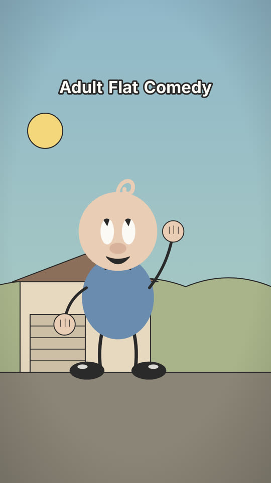<br><b>Adult Flat Comedy</b> · 2010s<br><sub>Flat, thin-lined, muted everyday sitcom sets with acid sci-fi rifts.</sub><br><sub><i>still · video coming soon</i></sub></td>
<td align="center" width="33%">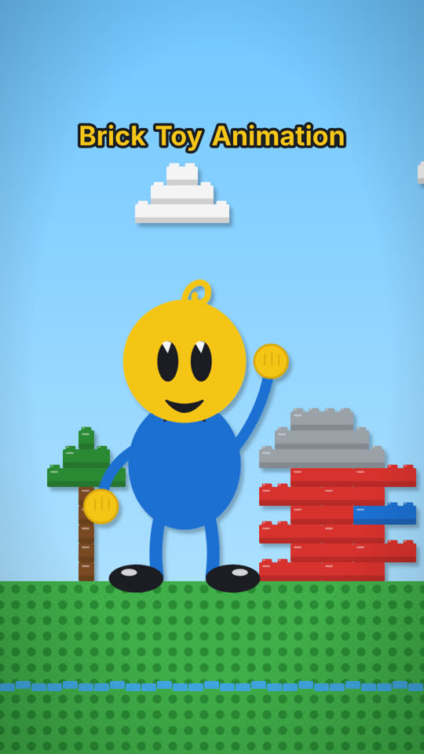<br><b>Brick Toy Animation</b> · 2010s<br><sub>A world built from generic plastic bricks: studs, gloss, stepped clouds.</sub><br><sub><i>still · video coming soon</i></sub></td>
</tr>
<tr>
<td align="center" width="33%">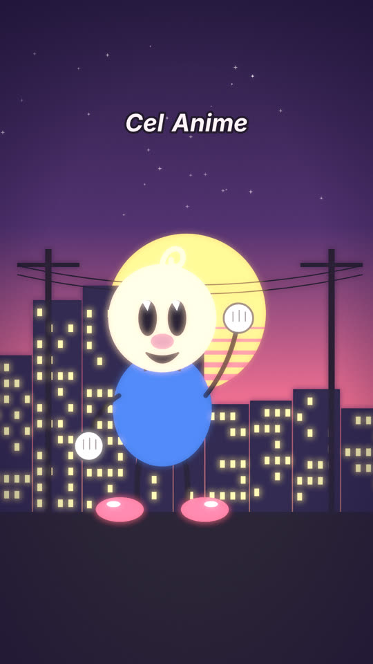<br><b>Cel Anime</b> · 1980s<br><sub>Hand-painted cels, airbrushed sunset, striped retro sun, glowing city lights.</sub><br><sub><i>still · video coming soon</i></sub></td>
<td align="center" width="33%">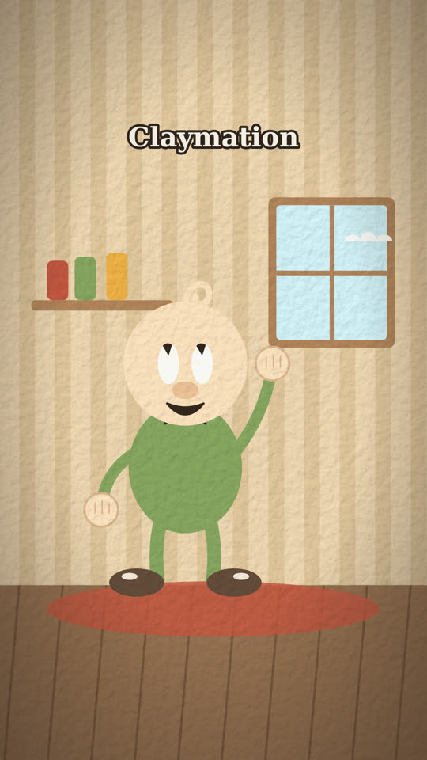<br><b>Claymation</b> · 1990s–2000s<br><sub>Plasticine with thumbprints, chunky cosy sets, 12 poses a second with chatter.</sub><br><sub><i>still · video coming soon</i></sub></td>
<td align="center" width="33%">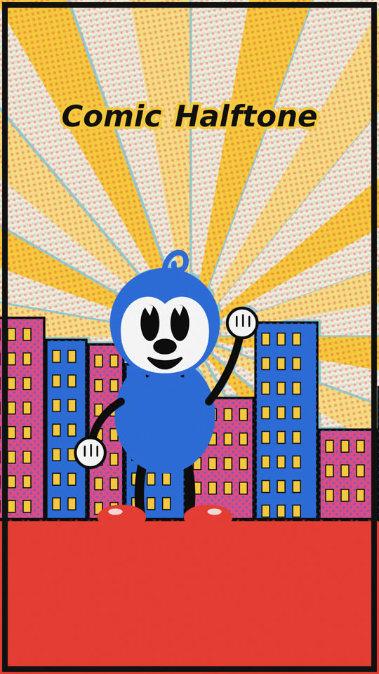<br><b>Comic Halftone</b> · 1960s pop<br><sub>Ben-Day dots, heavy outlines, print misregistration, sunburst and POP!</sub><br><sub><i>still · video coming soon</i></sub></td>
</tr>
<tr>
<td align="center" width="33%">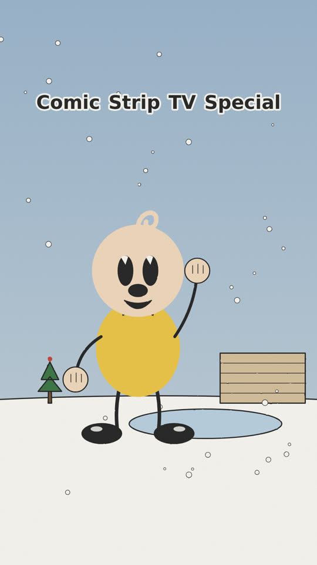<br><b>Comic Strip TV Special</b> · 1960s–80s<br><sub>Thin pen line, flat muted colours, one horizon line, big sky, gentle snow.</sub><br><sub><i>still · video coming soon</i></sub></td>
<td align="center" width="33%">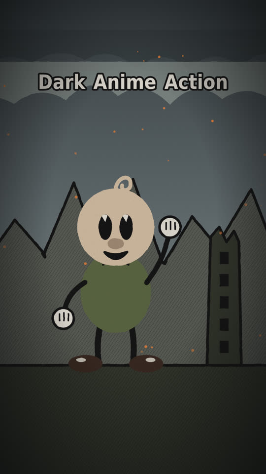<br><b>Dark Anime Action</b> · 2010s<br><sub>Grim action anime: steel palette, red accent, hatched shadows, embers, impact frames.</sub><br><sub><i>still · video coming soon</i></sub></td>
<td align="center" width="33%">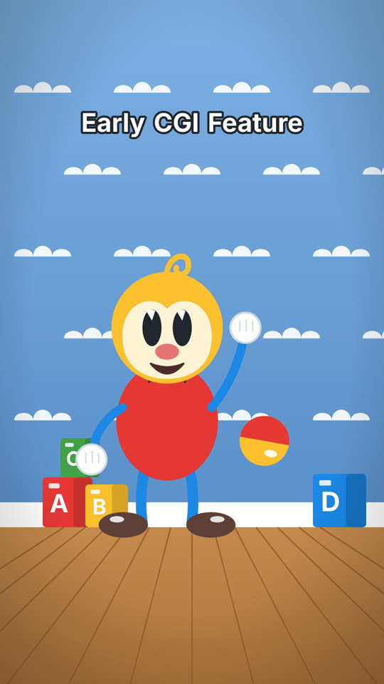<br><b>Early CGI Feature</b> · 1995–2001<br><sub>Glossy plastic, hard specular highlights, toy-scale room, crisp shadows.</sub><br><sub><i>still · video coming soon</i></sub></td>
</tr>
<tr>
<td align="center" width="33%">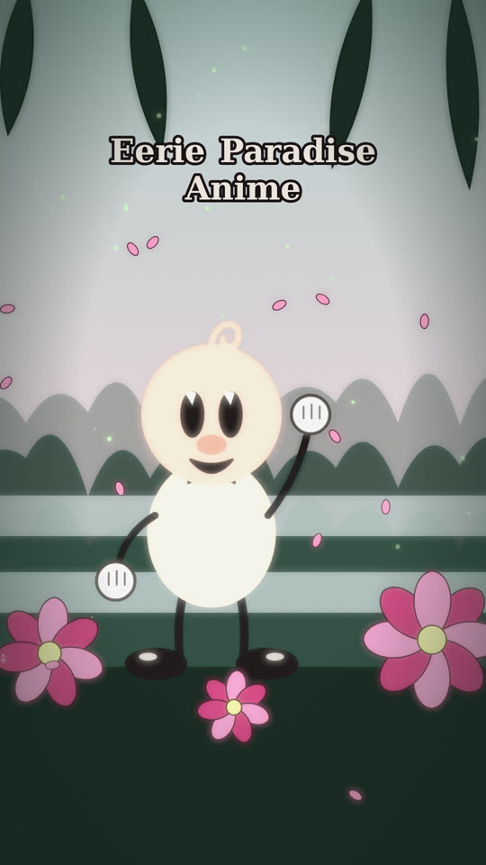<br><b>Eerie Paradise Anime</b> · 2020s<br><sub>Poison-bright flowers and misty jungle: a paradise that feels wrong.</sub><br><sub><i>still · video coming soon</i></sub></td>
<td align="center" width="33%">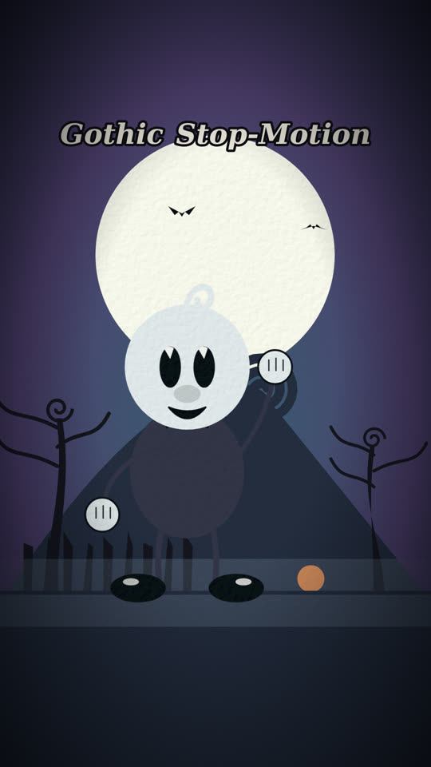<br><b>Gothic Stop-Motion</b> · 1990s–2010s<br><sub>Spindly puppets, a spiral hill, bare twisted trees, a huge moon, cold night.</sub><br><sub><i>still · video coming soon</i></sub></td>
<td align="center" width="33%">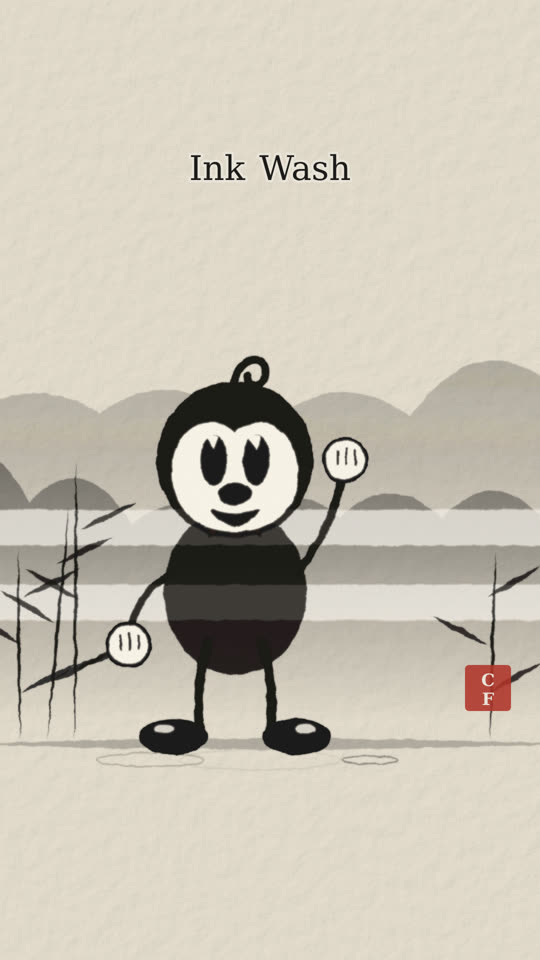<br><b>Ink Wash</b> · 1960s<br><sub>Brush and ink on rice paper: soft bleeding wash, mountains in mist, a red seal.</sub><br><sub><i>still · video coming soon</i></sub></td>
</tr>
<tr>
<td align="center" width="33%">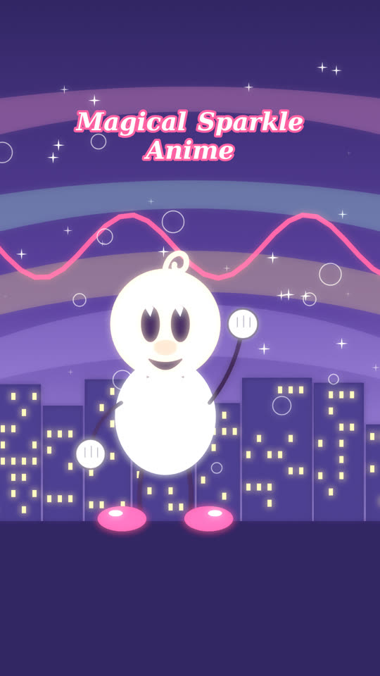<br><b>Magical Sparkle Anime</b> · 1990s<br><sub>Pastel pinks and lilacs, glitter, ribbons, shimmering transformation skies.</sub><br><sub><i>still · video coming soon</i></sub></td>
<td align="center" width="33%">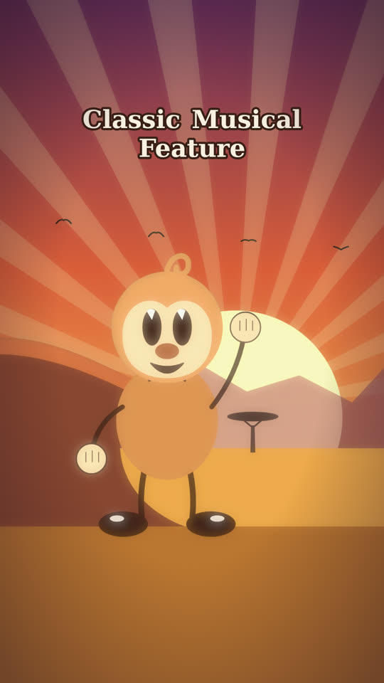<br><b>Classic Musical Feature</b> · 1990s<br><sub>Hand-drawn epic: painted vistas, giant sunset, god-rays, golden hour.</sub><br><sub><i>still · video coming soon</i></sub></td>
<td align="center" width="33%">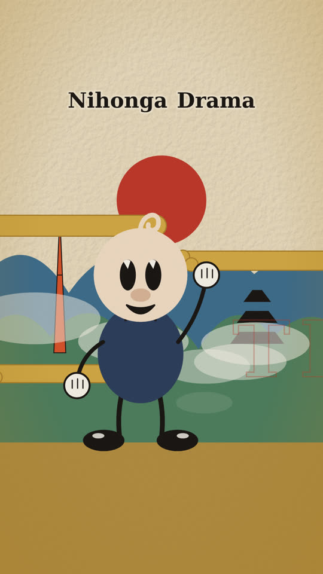<br><b>Nihonga Drama</b> · 2020s<br><sub>Mineral-pigment painting, gold-leaf clouds, a crimson sun, smoke and big type.</sub><br><sub><i>still · video coming soon</i></sub></td>
</tr>
<tr>
<td align="center" width="33%">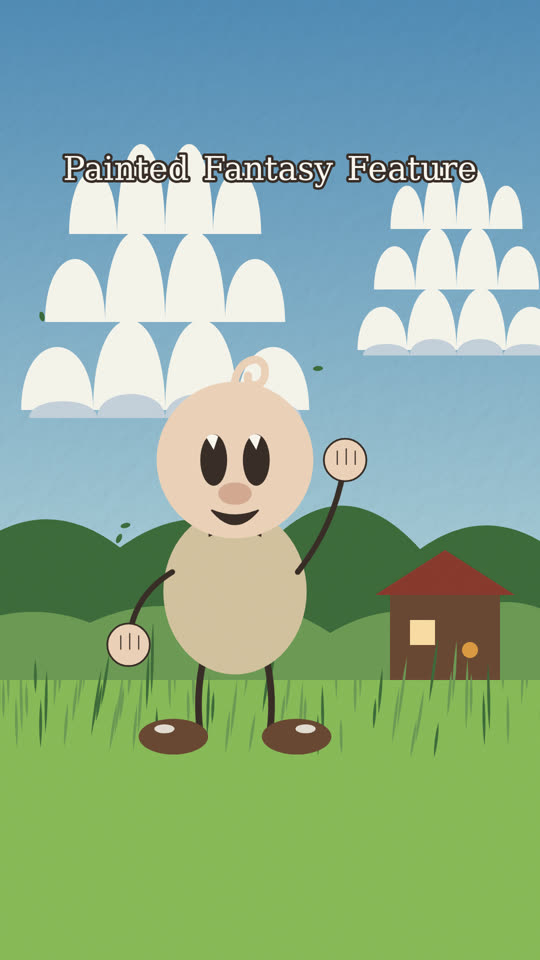<br><b>Painted Fantasy Feature</b> · 2000s<br><sub>Watercolour skies, towering clouds, wind through tall grass, lantern light.</sub><br><sub><i>still · video coming soon</i></sub></td>
<td align="center" width="33%">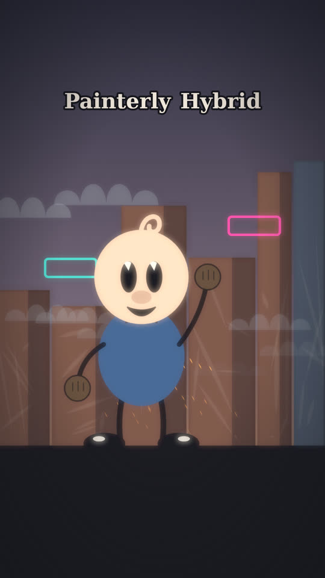<br><b>Painterly Hybrid</b> · 2020s<br><sub>Brush strokes painted over volume, graphic shadows, neon in smoky industrial dusk.</sub><br><sub><i>still · video coming soon</i></sub></td>
<td align="center" width="33%">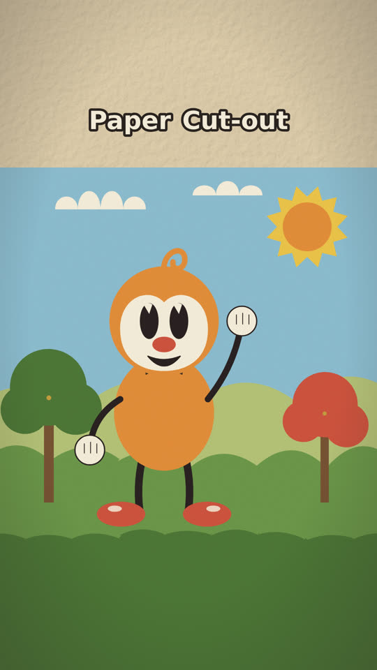<br><b>Paper Cut-out</b> · 1950s–60s<br><sub>Torn construction paper, brass fastener joints, layers casting little shadows.</sub><br><sub><i>still · video coming soon</i></sub></td>
</tr>
<tr>
<td align="center" width="33%">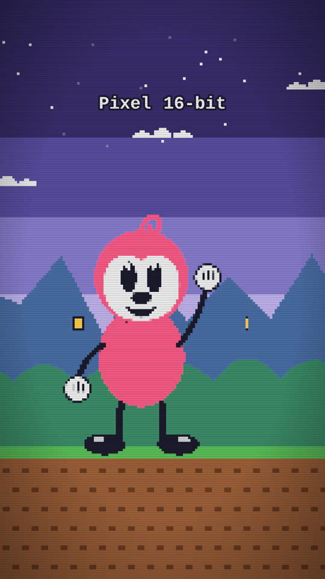<br><b>Pixel 16-bit</b> · early 1990s<br><sub>Chunky pixels, banded sky, parallax hills, spinning coins, chiptune.</sub><br><sub><i>still · video coming soon</i></sub></td>
<td align="center" width="33%">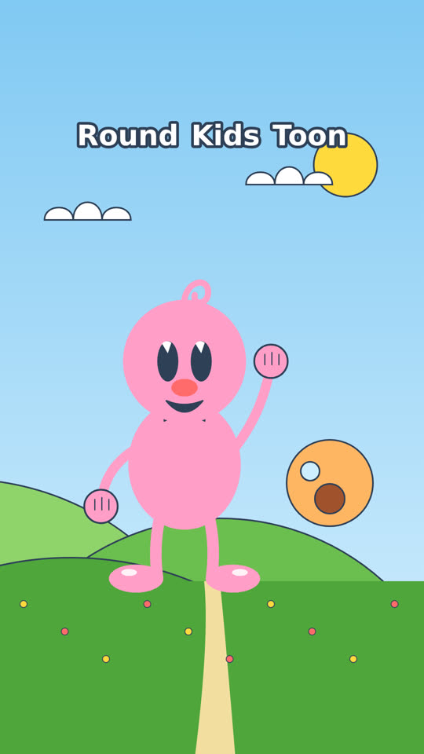<br><b>Round Kids Toon</b> · 2000s<br><sub>Characters made of circles, rolling green hills, bright friendly colours.</sub><br><sub><i>still · video coming soon</i></sub></td>
<td align="center" width="33%">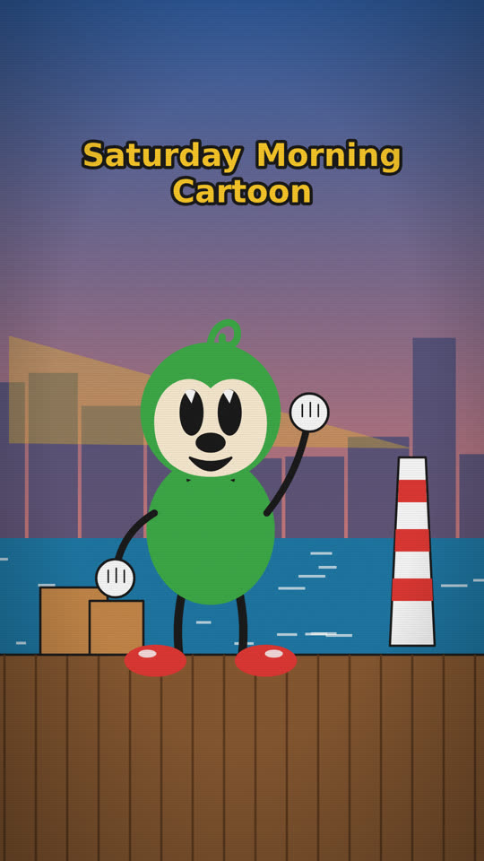<br><b>Saturday Morning Cartoon</b> · 1980s<br><sub>Clean TV cels, bold primaries, airbrushed skies, harbour adventures.</sub><br><sub><i>still · video coming soon</i></sub></td>
</tr>
<tr>
<td align="center" width="33%">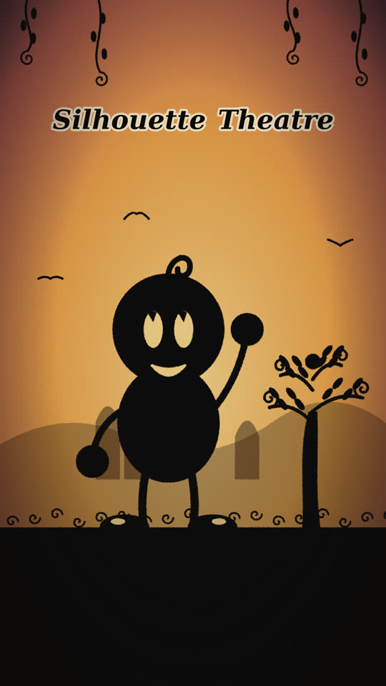<br><b>Silhouette Theatre</b> · 1920s<br><sub>Black cut-paper puppets with lace edges against a glowing backdrop. A fairy-tale waltz.</sub><br><sub><i>still · video coming soon</i></sub></td>
<td align="center" width="33%">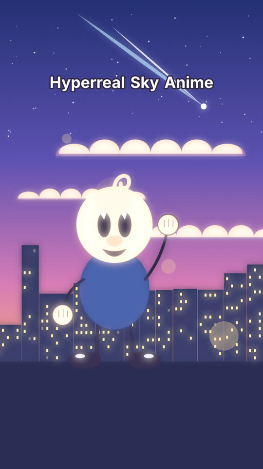<br><b>Hyperreal Sky Anime</b> · 2010s<br><sub>Photographic twilight skies, a comet trail, glittering city lights, lens flares.</sub><br><sub><i>still · video coming soon</i></sub></td>
<td align="center" width="33%">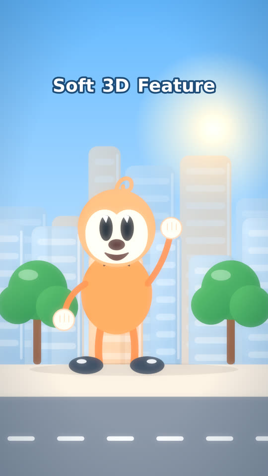<br><b>Soft 3D Feature</b> · 2010s<br><sub>The family 3D feature look in 2D: soft gradients, rim light, sunny rounded city.</sub><br><sub><i>still · video coming soon</i></sub></td>
</tr>
<tr>
<td align="center" width="33%">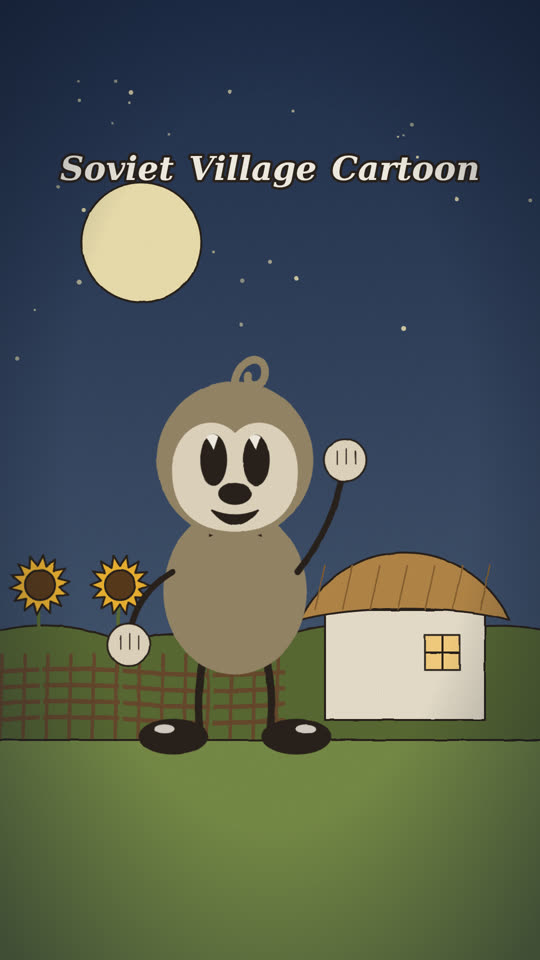<br><b>Soviet Village Cartoon</b> · 1980s<br><sub>Naive warm drawing, thatched huts, sunflowers, a wattle fence, a big moon.</sub><br><sub><i>still · video coming soon</i></sub></td>
<td align="center" width="33%">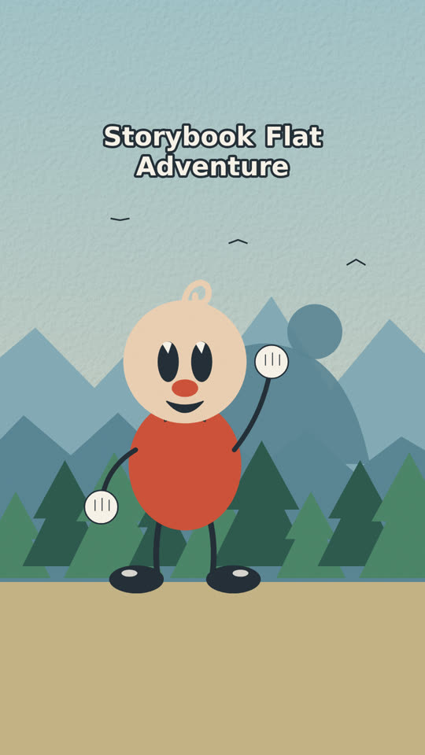<br><b>Storybook Flat Adventure</b> · 2010s<br><sub>Flat picture-book shapes, limited palette, Nordic mountains and a gentle giant.</sub><br><sub><i>still · video coming soon</i></sub></td>
<td align="center" width="33%">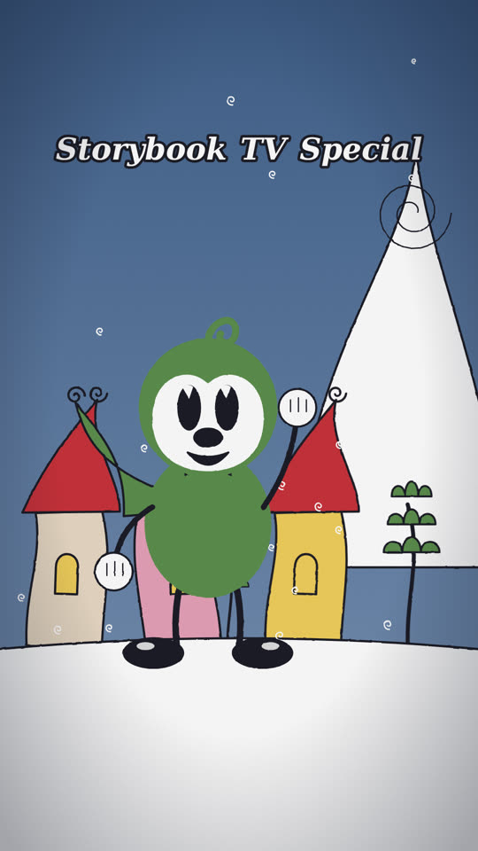<br><b>Storybook TV Special</b> · 1960s<br><sub>Impossibly curvy leaning houses, scratchy pen line, spiral snow, rhymes.</sub><br><sub><i>still · video coming soon</i></sub></td>
</tr>
<tr>
<td align="center" width="33%">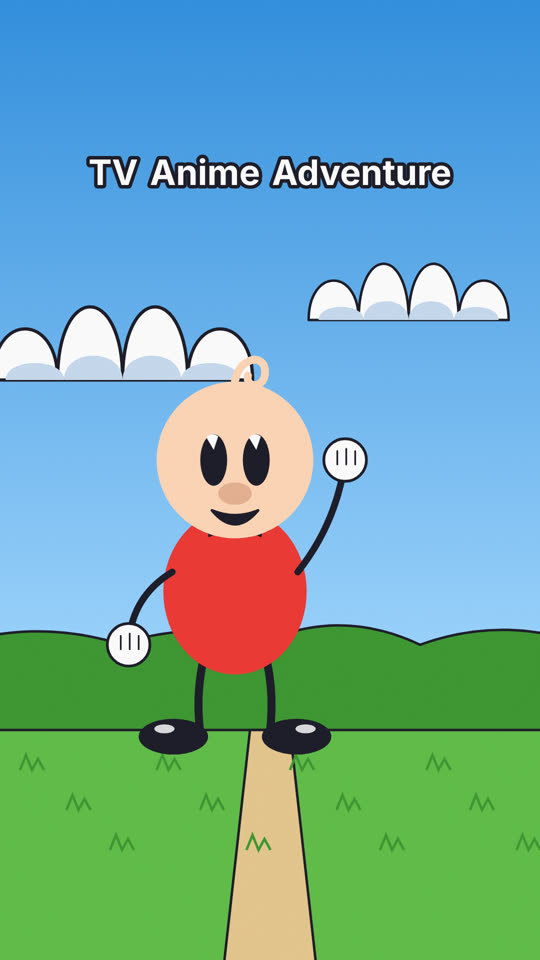<br><b>TV Anime Adventure</b> · late 1990s–2000s<br><sub>Bright TV anime: big blue sky, cel shadows, impact flashes and speed lines.</sub><br><sub><i>still · video coming soon</i></sub></td>
<td align="center" width="33%">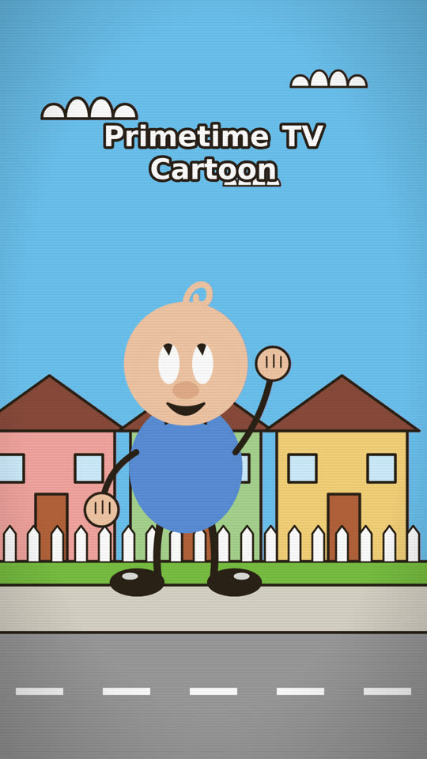<br><b>Primetime TV Cartoon</b> · 1990s<br><sub>Bright flat colours, even thick outlines, suburban street, a broadcast feel.</sub><br><sub><i>still · video coming soon</i></sub></td>
<td align="center" width="33%">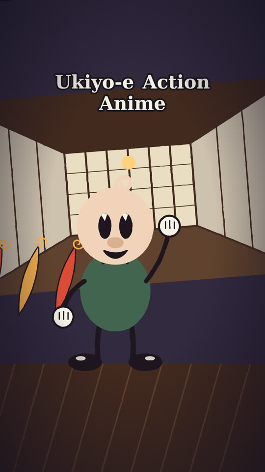<br><b>Ukiyo-e Action Anime</b> · 2020s<br><sub>Elemental swirls painted like woodblock prints over endless shifting halls.</sub><br><sub><i>still · video coming soon</i></sub></td>
</tr>
<tr>
<td align="center" width="33%">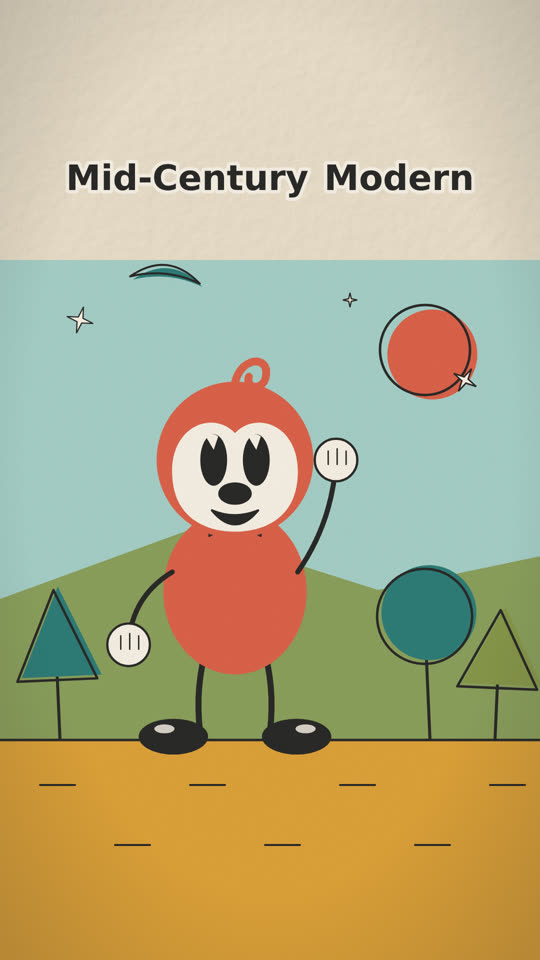<br><b>Mid-Century Modern</b> · 1950s<br><sub>Flat colour shapes, line drawn off the colour, atomic starbursts, cool jazz.</sub><br><sub><i>still · video coming soon</i></sub></td>
<td align="center" width="33%">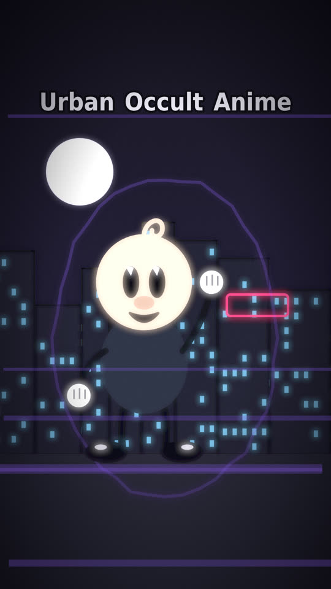<br><b>Urban Occult Anime</b> · 2020s<br><sub>Night city, deep black shadows, violet auras that crackle, glitch on impact.</sub><br><sub><i>still · video coming soon</i></sub></td>
<td align="center" width="33%">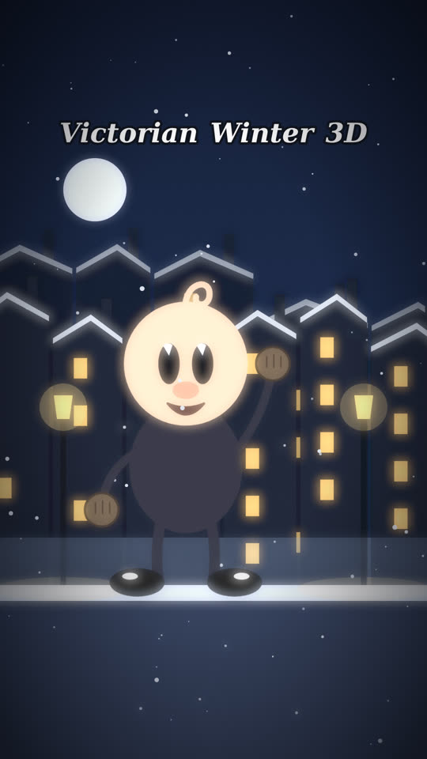<br><b>Victorian Winter 3D</b> · 2009<br><sub>Deep-blue night, falling snow, gas lamps, crooked rooftops and chimneys.</sub><br><sub><i>still · video coming soon</i></sub></td>
</tr>
<tr>
<td align="center" width="33%">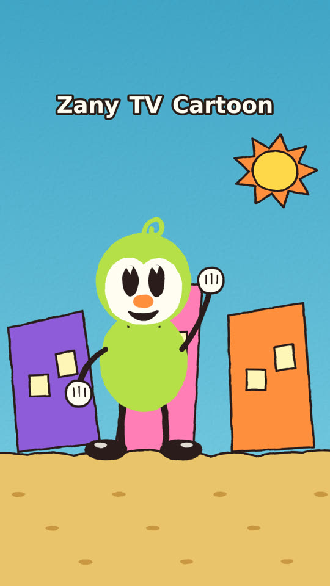<br><b>Zany TV Cartoon</b> · late 1990s<br><sub>Wobbly lively outlines, odd proportions, acid colours, everything breathes.</sub><br><sub><i>still · video coming soon</i></sub></td>
</tr>
</table>

▶ **Watch them with sound:** https://aleksandrarudenya99.github.io/cartoonforge
<!-- gallery:end -->

## Install

cartoonforge is a **skill for coding agents**. In Claude Code:

```text
/plugin marketplace add aleksandrarudenya99/cartoonforge
/plugin install cartoonforge@cartoonforge
```

or with the open skills CLI (Claude Code, Cursor, Codex, Gemini CLI…):

```bash
npx skills add aleksandrarudenya99/cartoonforge
```

Then just ask:

> Here are my two characters (a grumpy cat barista and a tiny robot). Make a 15-second reel in the
> Rubber Hose style about our coffee shop opening on Saturday.

> Here's my voice recording — turn it into a rubber hose cartoon with captions.

Requirements: **Node ≥ 22, FFmpeg, Google Chrome**. For the good free voice: `pip install kokoro soundfile`
(without it the skill falls back to macOS `say` or espeak-ng).

## How it works

No video model, no stock footage. Every frame is SVG drawn by code, captured by headless Chrome
([HyperFrames](https://github.com/heygen-com/hyperframes), Apache-2.0) and encoded by FFmpeg.

**Characters come from you** (a description, sketch or photo) — there is no house mascot. A cartoon
style is not a filter. It is five layers, and each one is code:

| Layer | Example (Rubber Hose · 1930) |
|---|---|
| Shape & line | one-curve "hose" limbs, pie-cut eyes, white gloves |
| Palette | black ink, warm paper, one grey |
| Timing | animated on twos (12 drawings/s), everything bounces at 120 bpm |
| Principles | big squash & stretch, anticipation before every jump |
| Texture | line boil, grain, dust, scratches, flicker, gate weave |

Plus sound, also per style: **captions** in the era's lettering, a **voice** (free TTS or your own
recording, treated by the style — e.g. a gramophone voice for the 1930s) and **music generated by
code** in the style's genre (ragtime for rubber hose), ducked under the voice and mastered to −14 LUFS
for Instagram.

```
skills/cartoonforge/
  SKILL.md                     what the agent follows
  runtime/core/                SHARED VIDEO: toon.js (time, motion, captions) · fx.js (textures, layers)
                               · scenes.js (title/end cards, iris, fade) · shapes.js (clouds, ridges, curls…)
  runtime/styles/<style>/      34 style packs: style.js (look + scenery) · style.json · README.md
  runtime/characters/          character spec (characters come from the user) + reference test rig
  scripts/lib/audio/           SHARED AUDIO: instruments · genres (29) · fx presets (voice, music, master)
  scripts/new-film.mjs         scaffold a film
  scripts/audio.mjs            voice (TTS or your recording) + music + captions
  scripts/stills.mjs           fast review: stills without rendering
  scripts/render.mjs           MP4 + contact sheet
examples/<style>/              test films that feed the gallery
```

## Develop

```bash
npm install                            # also copies the runtime into examples/*/lib
npm run dev                            # http://localhost:3000/viewer.html?film=rubber-hose-1930
npm run render -- examples/rubber-hose-1930 --draft
npm run showcase                       # re-render every style, rebuild README gallery + Pages site
```

### Add a style

1. Read [`references/new-style.md`](skills/cartoonforge/references/new-style.md).
2. Create `skills/cartoonforge/runtime/styles/<slug>/` with `README.md`, `style.js`, `style.json`.
3. `npm run showcase -- <slug>` — renders Pip in your style and adds the tile to the gallery.

## Legal notes

- Art **styles** are free to use; specific characters are not. Only draw **original characters**.
  No studio characters, logos or famous catchphrases.
- Music is generated by code → free to use. Don't commit other people's music.
- Voices: [Kokoro](https://github.com/hexgrad/kokoro) is Apache-2.0 (commercial use OK). Most Piper
  voices are non-commercial, so they are not used. Never clone someone else's voice.

This is not legal advice.

## License

MIT — see [LICENSE](LICENSE). HyperFrames (Apache-2.0) and GSAP keep their own licenses.
